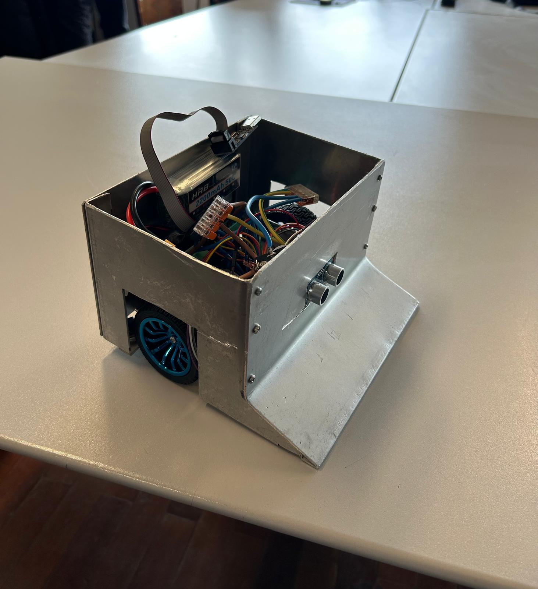
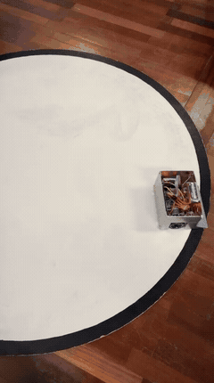

# Autonomous Sumo Robot (ATmega328P)

An autonomous mini-sumo robot built from scratch: a custom PCB designed in KiCad, a bare-metal C firmware for the ATmega328P (no Arduino libraries), and a hand-built aluminium chassis with a front ramp to push opponents out of the ring.

<p align="center">
  
  &nbsp;&nbsp;
  
</p>

Full match video: [`media/match.mp4`](media/match.mp4)


## How it works

Once powered, the robot waits 1 s and then runs a priority-based control loop with no human input:

1. **Front edge detected** (front line sensors see the black border): stop, reverse for 300 ms, then spin about 840 ms to face the arena again.
2. **Rear edge detected**: drive forward for 600 ms to get away from the border.
3. **Opponent within 20 cm** (ultrasonic sensor): charge at full attack speed. During the charge the robot keeps checking the front edge sensors, so it doesn't follow the opponent out of the ring.
4. **Nothing detected**: move forward slowly to search.

A status LED blinks at 1 Hz while the robot is running.

## Hardware

| Function | Component |
|---|---|
| Microcontroller | ATmega328P (DIP-28), 16 MHz crystal |
| Motor drivers | 2 × BTS7960 H-bridge |
| Motors | 2 × DC gear motors, differential drive |
| Opponent detection | HC-SR04 ultrasonic sensor |
| Edge detection | 4 × TCRT5000 reflective IR sensors (front left/right, rear left/right) |
| Power | 3S LiPo 2200 mAh (11.1 V) + step-down converter to 5 V |
| Chassis | Bent aluminium sheet with front ramp |

The PCB (2 layers, SMD passives) carries the microcontroller, the connectors for the drivers and sensors, and the regulator. KiCad 9 sources are in [`hardware/kicad/`](hardware/kicad).

### Pin mapping

| Signal | Pin | Peripheral |
|---|---|---|
| Left motor forward / reverse | PD6 / PD5 | Timer0 PWM (OC0A / OC0B) |
| Right motor forward / reverse | PD3 / PB2 | Timer2 PWM (OC2B) / Timer1 PWM (OC1B) |
| Line sensors (rear L, front L, front R, rear R) | PC0, PC1, PC2, PC3 | ADC0 to ADC3 |
| Ultrasonic trigger / echo | PB0 / PD2 | GPIO, pulse width measured in software |
| Status LED | PB1 | GPIO |

## Firmware

[`firmware/main.c`](firmware/main.c) is written directly against the AVR registers:

- **PWM:** three hardware timers (Timer0, Timer1, Timer2) in Fast PWM mode drive the four motor-driver inputs, which gives independent speed and direction control for each wheel.
- **ADC:** the reflective sensors are read with AV<sub>CC</sub> reference and a /64 prescaler, and compared against a threshold (`LIMITE_PRETO`) to detect the black border.
- **Ultrasonic ranging:** a 12 µs trigger pulse, then the echo pulse is timed in software with timeouts, so a missing echo can't hang the loop.
- **Tuning:** speeds, the detection distance and the edge threshold are all `#define` constants at the top of the file.

### Build and flash

```bash
avr-gcc -mmcu=atmega328p -Os -DF_CPU=16000000UL -o sumo.elf firmware/main.c
avr-objcopy -O ihex sumo.elf sumo.hex
avrdude -c usbasp -p m328p -U flash:w:sumo.hex
```

Atmel/Microchip Studio also works: create a GCC C project for the ATmega328P and add `main.c`.

## Possible improvements

- Use a timer interrupt and input capture to measure the ultrasonic echo without blocking the loop.
- Add side sensors so the robot can turn toward an opponent instead of only searching straight ahead.
- Add a start button with the 5 s delay required by competition rules.


